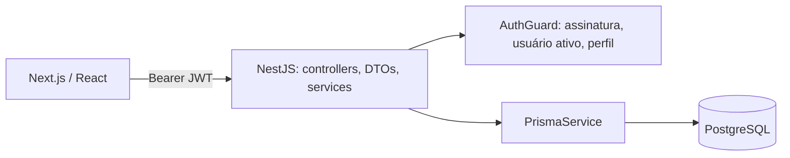
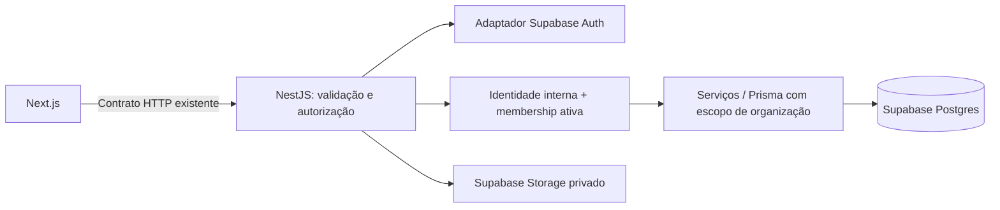

# Preparação do AgroIntegra para Supabase

> Registro da fase inicial. A implementação posterior de organizações e cadastro fechado está em [cadastro-por-convite.md](cadastro-por-convite.md); consulte esse documento para o estado atual. Nesta fase posterior foram aplicadas migrations apenas ao banco local, preservando os dados.

Status: preparação local, sem migração de dados, sem mudança do provedor de login e sem execução de SQL. O PostgreSQL atual e os contratos HTTP continuam sendo a referência funcional. A implementação de isolamento entre organizações ainda é futura; o sistema atual opera como uma única equipe.

## O que já foi organizado

- Módulo de configuração e verificação de tokens Supabase exclusivo da API, opt-in e desativado por padrão; nenhuma dependência nova.
- Autorização continua consultando o usuário ativo e o perfil no banco, com mensagens de sessão inválida uniformes.
- CORS com origens explícitas, cabeçalhos de segurança, limitação de falhas de login por IP/email e por IP, tratamento de erros internos sem detalhes privados na resposta ou logs brutos.
- Configuração pública centralizada no frontend; bloqueio de segredos em variáveis públicas durante a configuração do Next.js, com login legado preservado.
- Exemplos de ambiente sem credenciais reais, proteção de arquivos locais no `.gitignore`, arquitetura, modelo de dados e especificações de RLS/Storage para revisão.

Permanecem pendentes o vínculo definitivo de identidades, ciclo completo de sessão Supabase, memberships, escopo de organização nos serviços, migrations aditivas, políticas aplicadas e homologadas, cliente Storage e migração de dados/arquivos. O adaptador atual não é autorização para ativar esses recursos em produção.

## Arquitetura atual



- Monorepo npm: `apps/web` (Next.js 16 / React 19), `apps/api` (NestJS 11 / Prisma 6). `scripts/db.mjs` inicia PostgreSQL local via Docker ou embedded-postgres.
- Login próprio com bcrypt e JWT de oito horas; token em `sessionStorage`. O guard global exige autenticação e consulta o usuário a cada chamada. Login e health são públicos; auditoria exige `COORDINATION`.
- Controllers delegam aos serviços, DTOs usam class-validator e ValidationPipe rejeita campos não permitidos. Prisma mantém relações e transações; há SQL parametrizado nas agregações do painel.
- CPF é armazenado completo para consulta e sai mascarado pela API. Fotos, assinaturas e avatar estão em colunas binárias; PDF é gerado no servidor com PDFKit. Não há Supabase SDK nem Storage ativo.
- Notificações são vinculadas ao usuário, sem Realtime; auditoria é registrada no backend. `createdById` registra autoria e não representa propriedade exclusiva dos dados da equipe.

## Inventário dos contratos HTTP

| Área | Rotas e comportamento atual |
| --- | --- |
| Saúde / sessão | `GET /health`, `POST /auth/login`, `GET /auth/me` |
| Conta | `GET/PATCH /account`, `GET/PUT/DELETE /account/avatar`, `PATCH /account/password` |
| Produtores | `GET/POST /producers`, `GET/PATCH /producers/:id`, `POST /producers/:id/consent`, `POST /producers/:id/properties` |
| Propriedades | `GET /properties`, `PATCH /properties/:id` |
| Visitas | `GET/POST /visits`, `GET /visits/:id`, fotos e assinatura protegidas em `/visits/:id/...` |
| Solicitações | `GET/POST /requests`, `PATCH /requests/:id/status`, `PATCH /requests/:id/priority` |
| Painel / programas | `GET /dashboard`, `GET /programs`, `GET /programs/:id` |
| Relatórios | `GET /reports/producer/:id`, `GET /reports/producer/:id/pdf` |
| Avisos | `GET /notifications`, `GET /notifications/unread-count`, `PATCH /notifications/read-all`, `PATCH /notifications/:id/read` |
| Auditoria | `GET /audit` (coordenação) |

## Arquitetura proposta



Manter a API como fronteira pública. Preservar DTOs, serviços de negócio, máscaras de dados, PDFs, auditoria e contratos do frontend. Adaptar a conexão Prisma ao Postgres gerenciado e substituir a emissão/verificação de sessão apenas quando o fluxo Auth completo estiver pronto. Não basta mudar `DATABASE_URL` ou aceitar JWTs de dois emissores indistintamente.

O adaptador de autenticação deverá verificar assinatura, algoritmo permitido, issuer, audience e expiração (JWKS para chaves assimétricas; rotação e falhas fechadas), resolver `auth.users.id` para `User.id`, verificar usuário interno ativo e membership ativa em cada requisição. Role e organização enviados pelo cliente ou presentes em `user_metadata` não são autoridade. A sessão atual não implementa refresh/revogação Supabase; recuperação de senha, logout, alteração de senha, convites e desativação precisam migrar juntos.

A preparação já inclui um verificador opt-in, desativado por padrão, com ponte administrativa provisória por `app_metadata.agrointegra_user_id` e conferência do email. Essa ponte não implementa o ciclo completo de sessão nem o isolamento por organização. O usuário interno continua sendo a autoridade para perfil e status ativo; o frontend ainda usa o login legado.

Supabase Auth mantém credenciais; o perfil interno mantém dados do domínio. Não copiar hashes bcrypt para `auth.users` diretamente. Planejar convites/redefinição de senha ou importação oficialmente suportada em ambiente isolado, com correspondência de identidades auditável e sem vinculação automática só por email.

## Modelo de dados planejado

Os nomes abaixo são conceituais; os nomes Prisma atuais são mantidos nesta fase.

| Tabela atual / nova | Estrutura e adaptação planejadas |
| --- | --- |
| `Organization` (nova) | UUID, nome, ativo, timestamps. Representa secretaria/equipe isolada. |
| `User` | Preservar ID, perfil e preferências; adicionar `authUserId` UUID único, FK para `auth.users.id`. `passwordHash` só deixa de ser exigido após corte completo do login legado. |
| `OrganizationMember` (nova) | `organizationId`, `userId`, `role`, `active`, timestamps; par único. Perfis `COORDINATION` e `TECHNICIAN` por organização. |
| `Producer` | Dados atuais + `organizationId` obrigatório após backfill. Avaliar CPF único por organização, substituindo unicidade global somente em migração revisada. |
| `Property` | Dados atuais + organização; produtor e autor devem pertencer ao mesmo escopo. |
| `Visit` | Dados atuais + organização; produtor, propriedade, técnico e solicitação no mesmo escopo; preservar imutabilidade. |
| `VisitPhoto` | Organização, visita, posição, MIME e tamanho; futuro object key privado substitui bytes após validação do upload/cópia. |
| `ServiceRequest` | Organização, produtor/propriedade, autor, situação e datas atuais. |
| `Program` | Organização, orçamento em centavos, metas, período e unidades atuais. |
| `Enrollment` | Organização, produtor, programa e situação; preservar par único programa/produtor. |
| `Delivery` | Organização, produtor, programa, quantidade, valor e data. |
| `Notification` | Organização + destinatário; leitura e marcação apenas pelo próprio destinatário ativo. |
| `AuditLog` | Organização e ator opcional; escrita exclusiva do backend; leitura da coordenação do escopo; sem alteração pelo cliente. |

Adicionar índices de organização às consultas, unicidade composta `(organizationId, id)` e FKs compostas nas relações de domínio para impedir vínculos cruzados mesmo em SQL. Validar integridade de filhos e backfill antes de tornar colunas obrigatórias. Modelar audit logs de login falho sem organização em trilha privada do servidor, sem expor a todas as equipes. Usuários desativados ou sem membership não acessam dados. Membership e papel administrativo só podem ser provisionados por operação administrativa auditada.

Os rascunhos em `supabase/` usam os nomes SQL `tenants`, `tenant_memberships`, `tenant_id` para os mesmos conceitos de organização e membership acima. Apresentam também a alternativa de uma tabela `user_identities` para o vínculo único `auth_user_id` ↔ `legacy_user_id`, em vez de uma coluna `User.authUserId`. Antes de gerar migrations, escolher **uma única fonte canônica** para esse vínculo e alinhar Prisma, adaptador de autenticação e RLS; não manter dois mapas independentes.

## RLS e limites da conexão

O detalhamento das políticas fica em [supabase/README.md](../supabase/README.md). Nenhuma política está aplicada ao banco atual.

RLS controla linhas, não oculta `passwordHash` ou CPF dentro de uma linha autorizada. Não expor tabelas internas pela Data API; usar schema privado/não exposto e grants mínimos. Se houver acesso futuro via Data API, expor apenas views/contratos explicitamente revisados para não vazar colunas privadas.

Prisma usa conexão SQL e não propaga automaticamente JWT ou `auth.uid()`. A conexão de runtime deve ter papel dedicado sem `BYPASSRLS`, sem ser dona das tabelas e sem poder alterar políticas; o proprietário/migrador é separado. Definir em transação o contexto autenticado com valores derivados do token validado, usando SQL parametrizado e `SET LOCAL`/`set_config(..., true)` para evitar vazamento pelo pool, e demonstrar que o papel de runtime não consegue falsificar o contexto por caminhos de SQL expostos. Alternativamente, usar Data API com token do usuário nas operações que dependam de RLS. Essa escolha e os testes de concorrência são pré-requisitos do corte. Uma chave administrativa ou conexão de proprietário não prova isolamento por RLS.

## Storage planejado

Buckets privados separados para fotos de visitas, assinaturas e avatares. Chaves geradas no servidor com escopo de organização e ID de recurso; o caminho isoladamente não concede acesso. Resolver o recurso e a membership antes de baixar, subir ou emitir URL assinada de duração curta. Validar conteúdo/MIME/tamanho, impedir troca de proprietário e manter assinatura/visita imutáveis. Manter os endpoints atuais de download autenticado durante a transição.

Copiar blobs sem apagá-los, conferir tamanho/hash/contagem e registrar status. Upload no Storage e transação SQL não são atômicos: usar compensação/outbox para arquivos órfãos e referências quebradas. Só retirar bytes do banco em etapa futura autorizada, depois de ensaio de rollback.

## Ambiente e operação

- API: copiar `apps/api/.env.example` para `apps/api/.env`; manter segredos apenas no servidor ou secret manager do ambiente.
- Web: copiar `apps/web/.env.example` para `apps/web/.env.local`; somente a URL pública da API é necessária ao navegador nesta arquitetura.
- `DATABASE_URL`: conexão SQL de runtime. Localmente aponta ao PostgreSQL da demo; no futuro usar papel dedicado e TLS verificado no Supabase.
- `DIRECT_URL`: reservada para ferramentas de migração com conexão direta/session pooler apropriada. Ainda não é consumida pelo schema Prisma; não supor que preencher a variável muda o caminho de migrations.
- `JWT_SECRET`: segredo forte e exclusivo do backend para o login atual. `PORT` e `WEB_ORIGIN`: porta e origem exata do frontend.
- Variáveis futuras Supabase Auth/Storage e limites de segurança constam no exemplo da API; permanecer desabilitados por padrão. Nunca prefixar credenciais SQL, JWT secrets, chaves secretas ou `service_role` com `NEXT_PUBLIC_`.
- `SUPABASE_PUBLISHABLE_KEY` é reservada para um cliente futuro; o verificador JWT atual não a consome. URL e chave publicável fornecidas foram registradas somente no `.env` local da API, ignorado pelo Git. Isso não conecta o Prisma nem ativa login Supabase.
- Validar pooling/prepared statements para a versão Prisma instalada; separar credenciais de runtime e migrations, conexões por réplica e limites totais. Não publicar URLs de conexão em logs.
- `.env` de desenvolvimento não é configuração de produção. Definir HTTPS, secret manager, backups/restauração, retenção de auditoria e monitoramento antes da ativação.

## Sequência de implementação futura

1. Provisionar ambiente de homologação independente e aprovar organizações, papéis e matriz de acesso com responsáveis do produto.
2. Fazer backup com ensaio de restauração; gerar migrações aditivas revisadas, com mapeamento explícito dos registros legados para organização. Não deduzir organização somente por `createdById`.
3. Implementar vínculo Auth, ciclo completo de sessão e usuário interno, sem criar memberships a partir de dados do navegador.
4. Aplicar escopo nos serviços, relatórios, contagens, buscas por CPF, notificações de equipe e transações; criar FKs/grants/RLS revisados em homologação.
5. Provar negação de acesso anônimo, usuário inativo, membro removido, outra organização, escalada de perfil, vínculos cruzados e reutilização de conexão. Testar ambos os perfis e todos os contratos atuais.
6. Copiar arquivos para Storage privado com validação e rollback; provar que URLs e políticas não atravessam organizações.
7. Ensaiar o corte e restauração; obter autorização específica antes de qualquer mudança no banco de produção. Desligar login legado apenas após teste de paridade.

## Riscos e limites atuais

O modelo atual não tem isolamento por organização. Nesta fase, preparação não equivale a backend Supabase ativo ou produção homologada. O token no `sessionStorage` é acessível a JavaScript: avaliar cookies HttpOnly/Secure com estratégia CSRF e BFF quando migrar sessão. CORS não substitui autenticação. Rate limit em memória é por processo; produção com múltiplas réplicas precisa de armazenamento compartilhado e configuração explícita de proxy confiável. Evitar logs com tokens, credenciais, CPF integral ou conteúdo de assinatura.

Não executar `npm run setup`, `demo:reset`, `db:migrate`, `db:seed` ou `npm test` como validação desta preparação: o último aplica migrações e os e2e limpam tabelas. Compilar e executar unitários isolados não acessa o banco; e2e devem ser autorizados/configurados separadamente em banco descartável.

Validação isolada da API (sem banco):

```bash
npm run -w apps/api build
cd apps/api
npx jest --runInBand --runTestsByPath test/supabase.spec.ts test/http-security.spec.ts test/cpf.spec.ts
```

Validação do frontend a partir da raiz (Node.js com suporte nativo a TypeScript, validado em Node 24):

```bash
node --test apps/web/src/lib/backend-config.test.mjs
npm run -w apps/web build
```

Os testes HTTP isolados abrem somente uma porta local temporária e podem exigir permissão no sandbox; não carregam AppModule/Prisma nem executam migrations. E2E e políticas reais de RLS ainda precisam de homologação em banco descartável.

## Referências oficiais consultadas

- [Supabase com Prisma](https://supabase.com/docs/guides/database/prisma): conexão e pooling.
- [RLS](https://supabase.com/docs/guides/database/postgres/row-level-security) e [segurança da Data API](https://supabase.com/docs/guides/api/securing-your-api): políticas, grants e schemas.
- [JWT](https://supabase.com/docs/guides/auth/jwts) e [usuários](https://supabase.com/docs/guides/auth/users): identidade e limites de user metadata.
